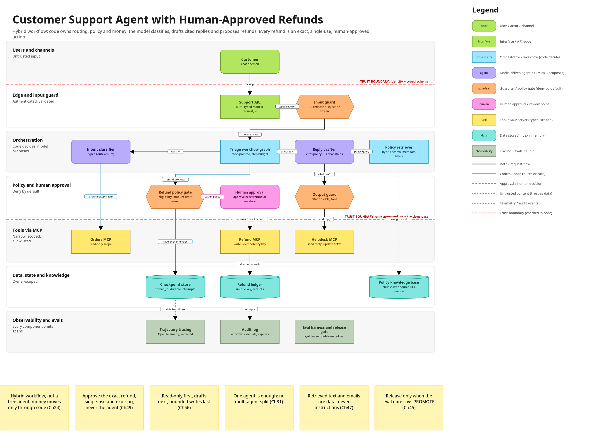
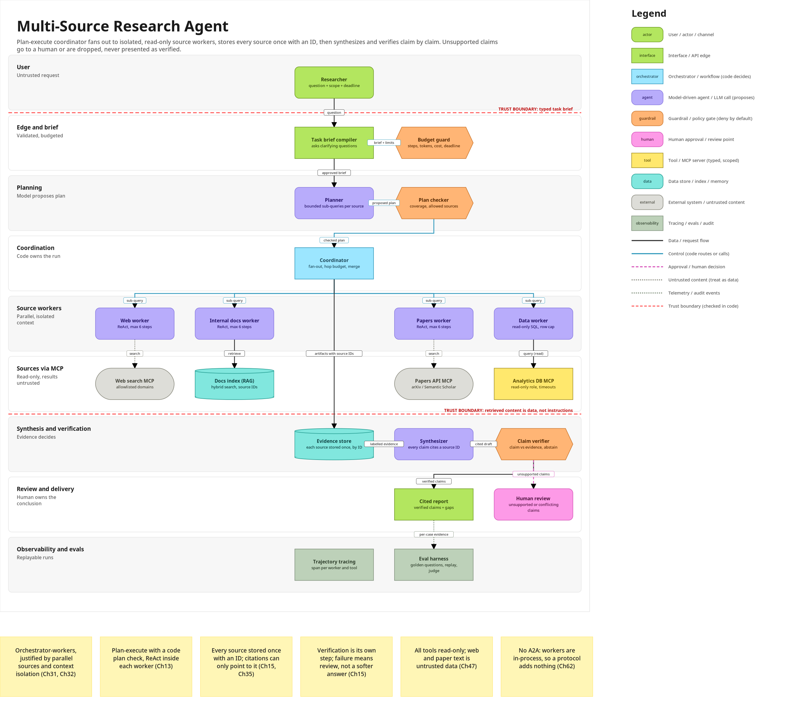

# Agentic Architect

**A free Claude Code skill that designs agentic AI systems the right way, then draws the architecture on your Miro board.**

Claude Code can write an agent in minutes, but left alone it builds whatever it guesses: one giant prompt, a "run anything" tool, no approvals, no budgets, no evals. Agentic Architect makes Claude design first, against the principles of the **A-Z of Agentic AI** course, and only then build.

When you describe what you want to build, the skill:

1. **Asks 8 short design questions** (goal, autonomy, tools, data and memory, risks, human approvals, latency and cost, evaluation), skipping anything you already said.
2. **Chooses patterns with explicit decision rules** (workflow vs agent, single vs multi-agent, ReAct vs plan-execute, RAG and memory types, MCP integration, guardrail layers, human-in-the-loop points, evals and tracing, deployment), each one citing the course chapter it comes from.
3. **Writes an architecture spec** (`ARCHITECTURE.md` + `architecture.json`): components, data flows, trust boundaries, failure handling, approvals, evals, risks with owners.
4. **Draws it on Miro** through Miro's official MCP server: layered lanes, trust-boundary lines, colour-coded components, labelled connectors, a legend, key-decision stickies and a design-rationale doc. No Miro? You get a Mermaid diagram and an SVG preview instead.
5. **Optionally writes `BUILD_PLAN.md`**, a vertical-slice-first plan that Claude Code follows so the code matches the design.





## Install

You need [Claude Code](https://docs.claude.com/en/docs/claude-code) and Python 3.9+ (standard library only).

Clone this repo, then copy the `agentic-architect` folder into Claude Code's skills directory.

**For all your projects (personal skill):**

```bash
git clone https://github.com/davolu/agentic-architect-skill.git
cd agentic-architect-skill
mkdir -p ~/.claude/skills
cp -r agentic-architect ~/.claude/skills/
```

**For one project (shared with your team through git):**

```bash
mkdir -p .claude/skills
cp -r agentic-architect .claude/skills/
```

Or unzip a release archive of the skill folder: `unzip agentic-architect.zip -d ~/.claude/skills/`. Restart Claude Code; the skill loads automatically when you ask it to design an agent. You can check with "What skills do you have?".

## Connect Miro (one time)

Miro's MCP server works on every Miro plan, including free.

**Option A, Miro's official Claude Code plugin:**

```bash
claude plugin install miro@claude-plugins-official
```

**Option B, add the MCP server directly:**

```bash
claude mcp add --transport http --scope user miro https://mcp.miro.com
```

Then authenticate: start Claude Code, run `/mcp`, choose **miro**, then **Authenticate**. Sign in to Miro in the browser, **pick the team** whose boards Claude may use, and approve. `/mcp` should now show miro as connected.

- Enterprise plans: an admin must enable MCP first (Admin settings, Apps & Integrations, MCP).
- Claude only sees boards in the team you picked. Re-authenticate to switch teams.
- Remove it any time with `claude mcp remove miro`.

If Miro is not connected, the skill tells you how to connect it and still gives you a Mermaid diagram (renders on GitHub) and an SVG preview.

## Example prompts

- "Design a customer-support agent that answers from our policy docs and can issue refunds, but a person approves every refund. Draw it on a new Miro board."
- "I want a research agent that searches the web, our Notion docs and arXiv and writes a cited report. Architect it first."
- "Review this agent design for security holes and redraw it: <paste or link>."
- "Design a coding agent that turns GitHub issues into tested PRs, then write the BUILD_PLAN.md."
- "Here is my Miro board <url>. Add the architecture for an email-triage agent next to what is there."

## What is inside

```
.
  README.md
  LICENSE
  docs/                            example diagrams shown above
  agentic-architect/               copy this folder into ~/.claude/skills/
    SKILL.md                         the 5-step process (kept short; details load on demand)
    references/
      decision-rules.md              D1-D12, each with course chapters
      patterns.md                    building blocks and when to use them
      design-checklist.md            the 8 questions, spec checklist, red flags
      security-guardrails.md         threat model, injection, layered guardrails, HITL
      evals-observability.md         eval dimensions, golden sets, tracing, release gate
      miro-drawing-guide.md          Miro MCP setup, tool workflow, layout and colours
      examples.md + examples/        worked architectures (JSON + Mermaid)
    templates/
      architecture-spec.md           ARCHITECTURE.md template
      architecture.example.json      spec format for the generator
      BUILD_PLAN.md                  build plan template
    scripts/
      spec_to_miro.py                spec -> Miro board SVG, Mermaid, local SVG preview
```

The generator is also handy on its own, from the repo root:

```bash
python3 agentic-architect/scripts/spec_to_miro.py architecture.json --check
python3 agentic-architect/scripts/spec_to_miro.py architecture.json --svg board.svg --mermaid architecture.mmd --preview preview.svg
```

## The principles it enforces

- The model proposes, the system disposes: code decides what is allowed, runs it and stops it.
- Least autonomy that works; irreversible actions behind deterministic code.
- One agent until a named reason justifies more.
- Narrow, typed, allowlisted tools; MCP standardizes transport, not authorization.
- Retrieved and tool content is data, never instructions.
- Approve exact actions, single-use and expiring.
- Budgets, idempotency and named stop reasons on every loop.
- Golden sets, tracing and a release gate before launch.

## Learn the course behind it

The rules come from **A-Z of Agentic AI**, a free 66-episode course by David Oluyale on the Agentic AI Hub YouTube channel: [youtube.com/@AgenticAIHub1](https://www.youtube.com/@AgenticAIHub1). The companion book, [A-Z of Agentic AI](https://535214083743.gumroad.com/l/qnjoqo), covers every chapter the skill cites.

## Free and MIT-licensed

Agentic Architect is free and MIT-licensed. Read the author's free book, [A-Z of Agentic AI](https://535214083743.gumroad.com/l/qnjoqo), by David Oluyale, Agentic AI Hub, and the course on the [Agentic AI Hub YouTube channel](https://www.youtube.com/@AgenticAIHub1).

## Credits and license

Created by **David Oluyale, Agentic AI Hub**. MIT License, see [LICENSE](LICENSE).

Miro and Claude are trademarks of their respective owners. This project is not affiliated with or endorsed by Miro or Anthropic.
